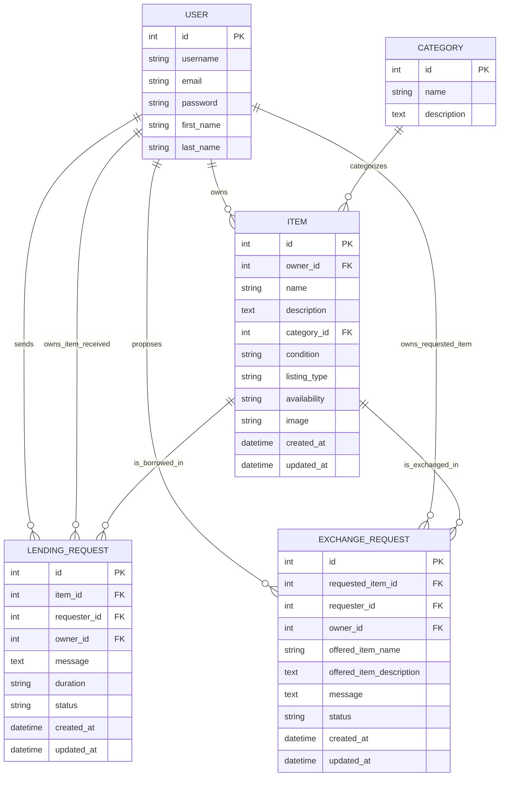

# Campus Item Lending & Exchange System — Complete Project Documentation

> **CA2 Problem Statement-Based Project**
> Built with Django 5.2, Python 3.14, SQLite, Django Templates (DTL), Custom CSS
> **Superuser:** `admin` / `admin123`

---

## Table of Contents

1. [Project Overview](#1-project-overview)
2. [Architecture](#2-architecture)
3. [Project Structure](#3-project-structure)
4. [Database Design (Models)](#4-database-design-models)
5. [ER Diagram](#5-er-diagram)
6. [URL Routing](#6-url-routing)
7. [Views — How Each One Works](#7-views--how-each-one-works)
8. [Forms](#8-forms)
9. [Templates](#9-templates)
10. [Authentication System](#10-authentication-system)
11. [Lending Workflow — Step by Step](#11-lending-workflow--step-by-step)
12. [Exchange Workflow — Step by Step](#12-exchange-workflow--step-by-step)
13. [Security & Validation](#13-security--validation)
14. [Django Syllabus Unit Mapping](#14-django-syllabus-unit-mapping)
15. [Viva Q&A](#15-viva-qa)
16. [Demo Script](#16-demo-script)

---

## 1. Project Overview

**Problem:** College students need items (calculators, books, lab equipment, chargers, sports gear, tools, stationery) for short periods. Buying them is expensive, while owners leave them unused. There is no centralized campus platform to list, discover, and manage lending/exchange.

**Solution:** A Django web app where students list items for **Lending** or **Exchange**, browse/search/filter items, send requests, and owners approve/reject/complete them.

**Tech Stack (strictly):**
- Backend: Python + Django (function-based views)
- Frontend: HTML5, CSS3, Vanilla JS (minimal), Django Templates (DTL)
- Database: SQLite + Django ORM
- Auth: Django built-in auth, sessions, login/logout, decorators
- No React/Node/MongoDB/DRF/Bootstrap/Tailwind/third-party APIs

---

## 2. Architecture

```
Browser (HTML/CSS/JS)
        │
        ▼
   Django URL Router (urls.py)
        │
        ▼
   Function-Based View (views.py)
        │
   ┌────┴────┐
   ▼         ▼
 Forms     Models (ORM)
   │         │
   ▼         ▼
 Validation  SQLite Database
   │
   ▼
 Template (DTL) → Rendered HTML
```

**Request flow:**
1. Browser sends HTTP request (GET or POST)
2. `campus_exchange/urls.py` routes to app (`accounts/` or `marketplace/`)
3. App `urls.py` maps URL → view function
4. View processes logic (ORM queries, validation, permission checks)
5. View renders a template with context data
6. HTML response sent back to browser

---

## 3. Project Structure

```
campus-tools/
├── manage.py                     # Django CLI entry point
├── db.sqlite3                    # SQLite database (all data)
├── campus_exchange/              # Project settings
│   ├── settings.py               # INSTALLED_APPS, DB, static, auth config
│   ├── urls.py                   # Root URL router + media serving
│   ├── wsgi.py / asgi.py         # Server entry points
│
├── accounts/                     # Auth app
│   ├── models.py                 # (empty — uses built-in User)
│   ├── views.py                  # register_view, login_view, logout_view
│   ├── forms.py                  # RegisterForm (extends UserCreationForm)
│   ├── urls.py                   # /accounts/register|login|logout/
│   └── admin.py
│
├── marketplace/                  # Core app
│   ├── models.py                 # Category, Item, LendingRequest, ExchangeRequest
│   ├── views.py                  # All marketplace views
│   ├── forms.py                  # ItemForm, LendingRequestForm, ExchangeRequestForm
│   ├── urls.py                   # All marketplace URLs (namespaced)
│   ├── admin.py                  # Admin registration for all models
│   ├── templatetags/marketplace_tags.py  # badge_class filter
│   └── migrations/
│       ├── 0001_initial.py       # Creates all 4 tables
│       └── 0002_seed_categories.py  # Seeds 9 categories
│
├── templates/
│   ├── base.html                 # Base template (inheritance)
│   ├── partials/navbar.html      # Reusable navbar
│   ├── partials/footer.html      # Reusable footer
│   ├── partials/messages.html    # Flash messages
│   ├── accounts/register.html    # Registration form
│   ├── accounts/login.html       # Login form
│   └── marketplace/              # 13 page templates
│
├── static/css/style.css          # All styling (custom CSS, green/teal theme)
└── media/items/                  # Uploaded item images
```

---

## 4. Database Design (Models)

### 4.1 Category (`marketplace/models.py:20`)
| Field | Type | Purpose |
|-------|------|---------|
| `name` | CharField(100) | e.g. "Books & Notes" |
| `description` | TextField(blank=True) | What this category contains |

- `Meta.ordering = ['name']` → alphabetical
- `__str__` returns name (shows in dropdowns/admin)

### 4.2 Item (`marketplace/models.py:38`)
| Field | Type | Purpose |
|-------|------|---------|
| `owner` | FK → User (CASCADE) | Who listed it |
| `name` | CharField(200) | Item name |
| `description` | TextField | Details |
| `category` | FK → Category (SET_NULL) | Category (nullable) |
| `condition` | CharField + choices | new / like_new / good / fair |
| `listing_type` | CharField + choices | lending / exchange |
| `availability` | CharField + choices | available / requested / lent_out / unavailable |
| `image` | ImageField(optional) | Photo in media/items/ |
| `created_at` | DateTimeField(auto_now_add) | Creation date |
| `updated_at` | DateTimeField(auto_now) | Last edit date |

- `Meta.ordering = ['-created_at']` → newest first
- Helper methods `get_condition_display_class()` / `get_availability_display_class()` return CSS badge classes

### 4.3 LendingRequest (`marketplace/models.py:128`)
| Field | Type | Purpose |
|-------|------|---------|
| `item` | FK → Item (CASCADE) | Item being borrowed |
| `requester` | FK → User (CASCADE) | Student who wants to borrow |
| `owner` | FK → User (CASCADE) | Item owner |
| `message` | TextField | Why they need it |
| `duration` | CharField(200) | e.g. "3 days", "1 week" |
| `status` | CharField + choices | pending/approved/rejected/cancelled/completed |
| `created_at` / `updated_at` | DateTimeField | Timestamps |

### 4.4 ExchangeRequest (`marketplace/models.py:179`)
| Field | Type | Purpose |
|-------|------|---------|
| `requested_item` | FK → Item (CASCADE) | Item they want |
| `requester` | FK → User (CASCADE) | Who proposes |
| `owner` | FK → User (CASCADE) | Item owner |
| `offered_item_name` | CharField(200) | Name of offered item |
| `offered_item_description` | TextField | Description of offered item |
| `message` | TextField(blank=True) | Optional note |
| `status` | CharField + choices | pending/accepted/rejected/cancelled/completed |
| `created_at` / `updated_at` | DateTimeField | Timestamps |

### 4.5 Relationships
- **User 1 → N Item** (owner)
- **User 1 → N LendingRequest** (as requester AND as owner)
- **User 1 → N ExchangeRequest** (as requester AND as owner)
- **Category 1 → N Item**
- **Item 1 → N LendingRequest**
- **Item 1 → N ExchangeRequest**

---

## 5. ER Diagram



---

## 6. URL Routing

### Root (`campus_exchange/urls.py`)
```python
path('admin/', admin.site.urls),
path('accounts/', include('accounts.urls')),
path('', include('marketplace.urls')),
```

### Accounts (`accounts/urls.py`)
| URL | View | Name |
|-----|------|------|
| `/accounts/register/` | `register_view` | `accounts:register` |
| `/accounts/login/` | `login_view` | `accounts:login` |
| `/accounts/logout/` | `logout_view` | `accounts:logout` |

### Marketplace (`marketplace/urls.py`) — namespaced `marketplace:`
| URL | View | Name |
|-----|------|------|
| `/` | `home` | `home` |
| `/about/` | `about` | `about` |
| `/browse/` | `browse_items` | `browse` |
| `/items/add/` | `add_item` | `add_item` |
| `/items/<int:pk>/` | `item_detail` | `item_detail` |
| `/items/<int:pk>/edit/` | `edit_item` | `edit_item` |
| `/items/<int:pk>/delete/` | `delete_item` | `delete_item` |
| `/dashboard/` | `dashboard` | `dashboard` |
| `/my-listings/` | `my_listings` | `my_listings` |
| `/profile/` | `profile` | `profile` |
| `/items/<int:item_pk>/borrow/` | `send_lending_request` | `send_lending_request` |
| `/requests/received/` | `lending_requests_received` | `lending_requests_received` |
| `/requests/sent/` | `lending_requests_sent` | `lending_requests_sent` |
| `/requests/<int:pk>/approve/` | `approve_lending_request` | `approve_lending_request` |
| `/requests/<int:pk>/reject/` | `reject_lending_request` | `reject_lending_request` |
| `/requests/<int:pk>/cancel/` | `cancel_lending_request` | `cancel_lending_request` |
| `/requests/<int:pk>/complete/` | `complete_lending_request` | `complete_lending_request` |
| `/items/<int:item_pk>/exchange/` | `send_exchange_request` | `send_exchange_request` |
| `/exchange/received/` | `exchange_requests_received` | `exchange_requests_received` |
| `/exchange/sent/` | `exchange_requests_sent` | `exchange_requests_sent` |
| `/exchange/<int:pk>/accept/` | `accept_exchange_request` | `accept_exchange_request` |
| `/exchange/<int:pk>/reject/` | `reject_exchange_request` | `reject_exchange_request` |
| `/exchange/<int:pk>/cancel/` | `cancel_exchange_request` | `cancel_exchange_request` |
| `/exchange/<int:pk>/complete/` | `complete_exchange_request` | `complete_exchange_request` |

**Dynamic URL parameters:** `<int:pk>` and `<int:item_pk>` capture integers from the URL and pass them as function arguments.

---

## 7. Views — How Each One Works

### 7.1 Public Views (no login required)

**`home(request)`** — `views.py:31`
- Queries 6 newest available items: `Item.objects.filter(availability='available').select_related('owner','category').order_by('-created_at')[:6]`
- `select_related` = SQL JOIN, avoids N+1 queries
- Counts total available items and distinct lenders
- Renders `marketplace/home.html`

**`about(request)`** — `views.py:54`
- Renders `marketplace/about.html` (static info page)

**`browse_items(request)`** — `views.py:59`
- Starts with all items, applies filters from GET params:
  - `q` → search name OR description using `Q(name__icontains=query) | Q(description__icontains=query)`
  - `category` → filter by category_id
  - `type` → filter by listing_type (lending/exchange)
  - `availability` → filter by availability (default 'available')
- `.distinct()` removes duplicates from OR queries
- Renders `marketplace/browse.html`

**`item_detail(request, pk)`** — `views.py:109`
- `get_object_or_404(Item, pk=pk)` → returns item or 404
- Checks `is_owner = request.user == item.owner`
- Checks if requester already has pending lending/exchange request
- Passes `lending_form` or `exchange_form` depending on listing_type
- Renders `marketplace/item_detail.html`

### 7.2 Item Management Views (`@login_required`)

**`add_item(request)`** — `views.py:147`
- GET → empty `ItemForm`
- POST → `ItemForm(request.POST, request.FILES)` (FILES for image upload)
- `form.save(commit=False)` → creates Item object WITHOUT saving to DB
- Sets `item.owner = request.user` and `item.availability = 'available'`
- `item.save()` → writes to DB
- Redirects to `my_listings` (POST-Redirect-GET pattern)

**`edit_item(request, pk)`** — `views.py:169`
- `get_object_or_404(Item, pk=pk)`
- **Ownership check:** `if request.user != item.owner` → error + redirect
- GET → `ItemForm(instance=item)` (pre-filled)
- POST → `ItemForm(request.POST, request.FILES, instance=item)` (updates existing)

**`delete_item(request, pk)`** — `views.py:196`
- Ownership check first
- Only accepts POST (delete button inside a form)
- `item.delete()` removes from DB

### 7.3 Dashboard & Profile Views

**`dashboard(request)`** — `views.py:221`
- `total_listings` = Item.objects.filter(owner=user).count()
- `total_pending_received` = pending LendingRequest + ExchangeRequest where owner=user
- `total_pending_sent` = pending requests where requester=user
- `active_lending` = approved LendingRequest where owner=user
- `recent_lending` / `recent_exchange` = last 4 incoming requests
- Renders `marketplace/dashboard.html`

**`my_listings(request)`** — `views.py:263`
- `Item.objects.filter(owner=request.user)` → user's items
- Renders `marketplace/my_listings.html`

**`profile(request)`** — `views.py:272`
- User's items, borrowing history (requester=user), lending history (owner=user)
- Renders `marketplace/profile.html`

### 7.4 Lending Request Views

**`send_lending_request(request, item_pk)`** — `views.py:300`
Validation chain (all server-side):
1. `item.owner == request.user` → "cannot request your own item"
2. `item.listing_type != 'lending'` → "not listed for lending"
3. `item.availability != 'available'` → "not available"
4. Duplicate pending check: `LendingRequest.objects.filter(item=item, requester=user, status='pending').exists()`
5. POST → `LendingRequestForm(request.POST)` → `form.save(commit=False)` → set item/requester/owner/status → save
6. Sets `item.availability = 'requested'` and saves

**`lending_requests_received(request)`** — `views.py:346`
- `LendingRequest.objects.filter(owner=request.user)` → requests for my items

**`lending_requests_sent(request)`** — `views.py:358`
- `LendingRequest.objects.filter(requester=request.user)` → my requests

**`approve_lending_request(request, pk)`** — `views.py:370`
1. Ownership check: `lending_req.owner != request.user`
2. Status check: `lending_req.status != 'pending'`
3. POST → set status='approved', save
4. Set item.availability='lent_out'
5. Auto-reject other pending: `LendingRequest.objects.filter(item=..., status='pending').exclude(pk=pk).update(status='rejected')`

**`reject_lending_request(request, pk)`** — `views.py:407`
- Same checks, sets status='rejected'
- If no other pending requests, restores item to 'available'

**`cancel_lending_request(request, pk)`** — `views.py:438`
- Check `lending_req.requester != request.user` (only requester can cancel)
- Check status=='pending'
- Sets status='cancelled', restores availability if no other pending

**`complete_lending_request(request, pk)`** — `views.py:469`
- Check owner, check status=='approved'
- Sets status='completed', item.availability='available' (item returned)

### 7.5 Exchange Request Views

**`send_exchange_request(request, item_pk)`** — `views.py:506`
- Same validation chain as lending, but for exchange items
- Saves ExchangeRequest with offered_item_name, offered_item_description, message

**`exchange_requests_received(request)`** — `views.py:548`
- `ExchangeRequest.objects.filter(owner=request.user)`

**`exchange_requests_sent(request)`** — `views.py:560`
- `ExchangeRequest.objects.filter(requester=request.user)`

**`accept_exchange_request(request, pk)`** — `views.py:572`
- Owner check, status=='pending' check
- Sets status='accepted', item.availability='lent_out'
- Auto-rejects other pending exchange proposals for same item

**`reject_exchange_request(request, pk)`** — `views.py:606`
- Sets status='rejected', restores availability if no other pending

**`cancel_exchange_request(request, pk)`** — `views.py:636`
- Requester check, status=='pending' check
- Sets status='cancelled', restores availability

**`complete_exchange_request(request, pk)`** — `views.py:666`
- Owner check, status=='accepted' check
- Sets status='completed', item.availability='unavailable' (exchanged)

---

## 8. Forms

### 8.1 RegisterForm (`accounts/forms.py:14`)
- Extends Django's `UserCreationForm` (provides username, password1, password2 + validation)
- Adds `first_name`, `last_name`, `email`
- `clean_email()` → checks email uniqueness
- `clean_username()` → checks username uniqueness
- `clean_<fieldname>()` is Django's field-level validation hook

### 8.2 ItemForm (`marketplace/forms.py:14`)
- `ModelForm` for `Item`
- Fields: name, description, category, condition, listing_type, image
- `owner` and `availability` excluded (set by view)
- `__init__` makes image optional, sets category empty_label

### 8.3 LendingRequestForm (`marketplace/forms.py:46`)
- Fields: message, duration
- item, requester, owner, status set programmatically in view

### 8.4 ExchangeRequestForm (`marketplace/forms.py:71`)
- Fields: offered_item_name, offered_item_description, message
- message is optional (`required=False`)

**ModelForm concept:** Automatically generates form fields from model fields. `fields` tuple in `Meta` controls which fields appear.

---

## 9. Templates

### 9.1 Template Inheritance
`base.html` defines the skeleton:
```html

<!DOCTYPE html>
<html>
<head>
    <title>Campus Exchange</title>
    <link rel="stylesheet" href="">
</head>
<body>
    
    <main>
        
        
    </main>
    
</body>
</html>
```

Every page does `` and fills ``.

### 9.2 DTL Features Used
- `` — inheritance
- `` / `` — overridable sections
- `` — reusable partials (navbar, footer, messages)
- `` — URL reversing
- `` / `` — loops
- `` / `` / `` — conditionals
- `{{ variable }}` — output
- `{{ obj.field }}` — attribute access
- `{{ value|filter }}` — filters (e.g. `badge_class`, `truncatechars`, `date`, `default`, `pluralize`)
- `` — CSRF protection
- `` — custom template tags

### 9.3 Custom Template Filter (`marketplace/templatetags/marketplace_tags.py`)
```python
@register.filter
def badge_class(value):
    return 'badge-' + str(value).replace('_', '-')
```
Converts `lent_out` → `badge-lent-out` for CSS styling.

---

## 10. Authentication System

### 10.1 Registration (`accounts/views.py:21`)
1. If already authenticated → redirect home
2. GET → empty `RegisterForm`
3. POST → `RegisterForm(request.POST)`
4. `form.is_valid()` → runs all validators + `clean_email()` + `clean_username()`
5. `form.save()` → creates User (password hashed automatically)
6. Flash success message, redirect to login (POST-Redirect-GET)

### 10.2 Login (`accounts/views.py:56`)
1. If already authenticated → redirect dashboard
2. GET → empty `AuthenticationForm`
3. POST → `AuthenticationForm(request, data=request.POST)`
4. `form.is_valid()` → Django checks username + password
5. `form.get_user()` → returns validated User object
6. `login(request, user)` → stores user ID in session
7. Redirect to `next` URL if provided, else dashboard

### 10.3 Logout (`accounts/views.py:94`)
- Only accepts POST (prevents GET-based logout attacks)
- `logout(request)` → clears session data
- Redirect to home

### 10.4 Session Handling
- Django stores session ID in a cookie
- `request.user` is populated by `AuthenticationMiddleware`
- `@login_required` decorator redirects unauthenticated users to `LOGIN_URL`

---

## 11. Lending Workflow — Step by Step

```
Student A lists calculator (Lending, Available)
        │
        ▼
Student B browses, opens detail, submits request
        │
        ▼
send_lending_request() validates:
  - not own item ✓
  - listing_type == lending ✓
  - availability == available ✓
  - no duplicate pending ✓
        │
        ▼
Creates LendingRequest (status=pending)
Sets Item.availability = 'requested'
        │
        ▼
Student A sees request in Requests Received
        │
   ┌────┴────┐
   ▼         ▼
Approve    Reject
   │         │
   ▼         ▼
status=   status=
approved  rejected
Item.     If no other
avail=    pending →
'lent_out'  avail=
          'available'
   │
   ▼
Other pending requests auto-rejected
        │
        ▼
Student B sees "Approved" in Requests Sent
        │
        ▼
After return, Student A clicks "Mark Returned"
        │
        ▼
complete_lending_request():
  status='completed'
  Item.availability='available'
```

**Status transitions (LendingRequest):**
- `pending` → `approved` (owner approves)
- `pending` → `rejected` (owner rejects)
- `pending` → `cancelled` (requester cancels)
- `approved` → `completed` (owner marks returned)

**Item availability changes:**
- `available` → `requested` (when request sent)
- `requested` → `lent_out` (when approved)
- `lent_out` → `available` (when completed)
- `requested` → `available` (when rejected/cancelled with no other pending)

---

## 12. Exchange Workflow — Step by Step

```
Student A lists book (Exchange, Available)
        │
        ▼
Student B opens detail, submits proposal
  (offered_item_name, offered_item_description, message)
        │
        ▼
send_exchange_request() validates:
  - not own item ✓
  - listing_type == exchange ✓
  - availability == available ✓
  - no duplicate pending ✓
        │
        ▼
Creates ExchangeRequest (status=pending)
Sets Item.availability = 'requested'
        │
        ▼
Student A sees proposal in Exchange Received
        │
   ┌────┴────┐
   ▼         ▼
Accept     Reject
   │         │
   ▼         ▼
status=   status=
accepted  rejected
Item.     If no other
avail=    pending →
'lent_out'  avail=
          'available'
   │
   ▼
Other pending proposals auto-rejected
        │
        ▼
Student A clicks "Mark Complete"
        │
        ▼
complete_exchange_request():
  status='completed'
  Item.availability='unavailable'
```

**Status transitions (ExchangeRequest):**
- `pending` → `accepted` (owner accepts)
- `pending` → `rejected` (owner rejects)
- `pending` → `cancelled` (requester cancels)
- `accepted` → `completed` (owner confirms done)

---

## 13. Security & Validation

| Protection | Where | How |
|-----------|-------|-----|
| CSRF | All POST forms | `` in templates, `CsrfViewMiddleware` |
| Login required | All protected views | `@login_required` decorator |
| Ownership (edit/delete item) | `edit_item`, `delete_item` | `if request.user != item.owner` |
| Ownership (approve/reject/complete) | All request action views | `if req.owner != request.user` |
| Ownership (cancel) | `cancel_lending_request`, `cancel_exchange_request` | `if req.requester != request.user` |
| No self-request | `send_lending_request`, `send_exchange_request` | `if item.owner == request.user` |
| No duplicate pending | Both send views | `.filter(item=..., requester=..., status='pending').exists()` |
| No requesting unavailable | Both send views | `if item.availability != 'available'` |
| Valid status transitions | All action views | `if req.status != 'pending'` / `'approved'` / `'accepted'` |
| POST-only actions | All action views | `if request.method == 'POST'` |
| Password validation | Registration | `AUTH_PASSWORD_VALIDATORS` in settings |
| Unique email/username | Registration | `clean_email()`, `clean_username()` |
| 404 for missing objects | All detail views | `get_object_or_404()` |

**Key principle:** Every permission is checked in the **backend view**, not just hidden in HTML. Hiding a button is UX; the view check is security.

---

## 14. Django Syllabus Unit Mapping

| Unit | Concept | Where Demonstrated |
|------|---------|-------------------|
| **I — Intro** | venv, install, project, apps, manage.py, settings | `venv/`, `manage.py`, `campus_exchange/`, `accounts/`, `marketplace/`, `INSTALLED_APPS` |
| **II — Views & URLs** | FBVs, URL routing, dynamic params, GET/POST, redirects, 404 | All views, `urls.py` with `<int:pk>`, `redirect()`, `get_object_or_404` |
| **III — Templates & DTL** | Variables, loops, if/else, inheritance, base template, partials | `base.html`, ``, ``, ``, ``, filters |
| **IV — Forms** | ModelForm, GET/POST, validation, errors, CSRF, PRG | `ItemForm`, `LendingRequestForm`, `ExchangeRequestForm`, `RegisterForm`, ``, redirect after POST |
| **V — Models/ORM/Admin** | Models, migrations, SQLite, FK, querysets, filtering, ordering, admin | `models.py`, `migrations/`, `admin.py`, `.filter()`, `.order_by()`, `select_related`, `Q` objects |
| **VI — Auth/Sessions** | Registration, login, logout, sessions, login_required, user-specific data | `accounts/views.py`, `@login_required`, `request.user`, `login()`/`logout()` |

---

## 15. Viva Q&A

**Q1: What is Django?**
A: A high-level Python web framework that follows the MTV (Model-Template-View) pattern. It provides ORM, admin, auth, URL routing, and template engine out of the box.

**Q2: What is MTV vs MVC?**
A: MTV = Model (data), Template (presentation), View (logic). MVC = Model-View-Controller. Django's "View" is like MVC's Controller; Django's "Template" is like MVC's View.

**Q3: What is ORM?**
A: Object-Relational Mapper. Lets you write Python code instead of SQL. `Item.objects.filter(owner=user)` becomes `SELECT * FROM item WHERE owner_id = ?`.

**Q4: What is a ForeignKey?**
A: Creates a many-to-one relationship. `Item.owner = ForeignKey(User)` means many items belong to one user. `on_delete=CASCADE` deletes items when user is deleted; `SET_NULL` sets to NULL.

**Q5: What is a ModelForm?**
A: A form automatically generated from a model. Define `Meta.model` and `Meta.fields`; Django creates the form fields, validation, and save logic.

**Q6: What is `commit=False`?**
A: `form.save(commit=False)` returns the model object WITHOUT saving to DB. Lets you set extra fields (like `owner`) before calling `.save()`.

**Q7: What is `@login_required`?**
A: A decorator that redirects unauthenticated users to `LOGIN_URL`. Applied to views that need authentication.

**Q8: What is CSRF? Why ``?**
A: Cross-Site Request Forgery. An attacker tricks a logged-in user's browser into submitting a malicious POST. `` adds a hidden token that Django validates, blocking forged requests.

**Q9: What is POST-Redirect-GET?**
A: After processing a POST, redirect to another page instead of rendering. Prevents form resubmission on refresh. Used in all views: `return redirect(...)` after `form.save()`.

**Q10: What is `select_related`?**
A: Performs a SQL JOIN to fetch related objects in one query. Avoids N+1 query problem. Used in `home`, `browse_items`, `dashboard`.

**Q11: What are `Q` objects?**
A: Allow complex queries with OR/AND. `Q(name__icontains=q) | Q(description__icontains=q)` searches name OR description.

**Q12: What is `get_object_or_404`?**
A: Shortcut that returns the object if found, else raises Http404. Cleaner than try/except.

**Q13: How do you prevent duplicate requests?**
A: Before saving, check `LendingRequest.objects.filter(item=item, requester=user, status='pending').exists()`. If True, show warning and redirect.

**Q14: How do you prevent users from editing others' listings?**
A: In `edit_item` and `delete_item`, check `if request.user != item.owner` → error message + redirect. This is server-side, not just hidden buttons.

**Q15: What is `related_name`?**
A: Name for reverse relation. `owner = ForeignKey(User, related_name='items')` lets you do `user.items.all()` instead of `user.item_set.all()`.

**Q16: What is `auto_now_add` vs `auto_now`?**
A: `auto_now_add=True` sets field to current time when object is FIRST created. `auto_now=True` updates field every time object is saved.

**Q17: What is the difference between `null=True` and `blank=True`?**
A: `null=True` is database-level (allows NULL in DB). `blank=True` is form-level (allows empty in forms). Use both for optional fields.

**Q18: How does authentication work?**
A: `authenticate()` verifies credentials. `login()` stores user ID in session. `logout()` clears session. `request.user` is populated by `AuthenticationMiddleware`.

**Q19: What is a session?**
A: Server-side storage keyed by a session ID stored in a browser cookie. Django stores sessions in DB by default. Keeps user logged in across requests.

**Q20: What is URL namespacing?**
A: `app_name = 'marketplace'` in urls.py lets you use ``. Prevents name collisions between apps.

**Q21: What is a template filter?**
A: A function that transforms a variable. `{{ item.availability|badge_class }}` calls `badge_class(item.availability)`. Custom filters defined in `templatetags/`.

**Q22: How do you handle file uploads?**
A: Form needs `enctype="multipart/form-data"`. View uses `request.FILES`. `ImageField(upload_to='items/')` saves to `media/items/`. Settings define `MEDIA_URL` and `MEDIA_ROOT`.

**Q23: What is Django Admin?**
A: Auto-generated admin interface. Register models in `admin.py`. Access at `/admin/`. `list_display`, `list_filter`, `search_fields` customize the list view.

**Q24: What is a migration?**
A: A Python file that records model changes. `makemigrations` creates them; `migrate` applies them to DB. Keeps DB schema in sync with models.

**Q25: What is the messages framework?**
A: `messages.success(request, '...')` stores a flash message. `` renders it. Shown once then cleared.

**Q26: Why is `logout` POST-only?**
A: Prevents attackers from logging users out via a crafted link (GET request). The logout button is inside a form with ``.

**Q27: What happens when a request is approved?**
A: Status → 'approved', item availability → 'lent_out', all OTHER pending requests for same item auto-rejected.

**Q28: What happens when lending is completed?**
A: Status → 'completed', item availability → 'available' (item returned, can be borrowed again).

**Q29: What is the difference between Lending and Exchange?**
A: Lending = borrow temporarily, return later. Exchange = swap items permanently. LendingRequest has `duration`; ExchangeRequest has `offered_item_name` + `offered_item_description`.

**Q30: What database do you use?**
A: SQLite (file-based, no server needed). Configured in `settings.py` under `DATABASES`. Django ORM abstracts the SQL.

---

## 16. Demo Script

### Setup (one-time)
```bash
cd /Users/ayush/Desktop/campus-tools
source venv/bin/activate
python manage.py migrate          # Apply migrations + seed categories
python manage.py createsuperuser  # Create admin (or use admin/admin123)
python manage.py runserver        # Start server
```

### Full Demo Flow
1. Open `http://127.0.0.1:8000/` → Homepage with hero, categories, featured items
2. Go to `/accounts/register/` → Register **Student A** (e.g. Rahul Sharma)
3. Register **Student B** (e.g. Priya Patel)
4. Login as Student A → Dashboard
5. Add Item: "Casio fx-991ES Calculator", Category=Calculators, Condition=Good, Type=Lending
6. Add Item: "Engineering Drawing Kit", Category=Stationery, Condition=Like New, Type=Exchange
7. Logout
8. Login as Student B → Browse Items
9. Search "calculator" → finds it
10. Open calculator detail → Send Borrow Request (message + duration)
11. Open book detail → Send Exchange Proposal (offered item name + description)
12. Logout
13. Login as Student A → Requests Received → see lending request → **Approve**
14. Exchange Requests Received → see proposal → **Accept**
15. Dashboard shows updated stats
16. Requests Received → Mark Returned (lending) → item becomes Available
17. Exchange Requests Received → Mark Complete → item becomes Unavailable
18. Show `/admin/` → manage users, categories, items, requests
19. Show that Student B cannot edit Student A's listing (ownership check)
20. Show that duplicate pending requests are blocked

### Key Screenshots to Capture
- Homepage with featured items
- Browse page with search + filters
- Item detail with request form
- Dashboard with stats
- Requests Received with Approve/Reject buttons
- Requests Sent with Cancel button
- Django Admin item list
- Error message when trying to edit someone else's item

---

## Quick Reference: File → Purpose

| File | Purpose |
|------|---------|
| `manage.py` | Django CLI entry point |
| `campus_exchange/settings.py` | Project config (apps, DB, static, auth) |
| `campus_exchange/urls.py` | Root URL router |
| `accounts/views.py` | Register, login, logout |
| `accounts/forms.py` | RegisterForm |
| `accounts/urls.py` | /accounts/ routes |
| `marketplace/models.py` | Category, Item, LendingRequest, ExchangeRequest |
| `marketplace/views.py` | All marketplace views |
| `marketplace/forms.py` | ItemForm, LendingRequestForm, ExchangeRequestForm |
| `marketplace/urls.py` | All marketplace routes |
| `marketplace/admin.py` | Admin registration |
| `marketplace/templatetags/marketplace_tags.py` | badge_class filter |
| `marketplace/migrations/0001_initial.py` | Creates tables |
| `marketplace/migrations/0002_seed_categories.py` | Seeds 9 categories |
| `templates/base.html` | Base template |
| `templates/partials/` | navbar, footer, messages |
| `templates/marketplace/` | 13 page templates |
| `templates/accounts/` | register.html, login.html |
| `static/css/style.css` | All styling |
| `db.sqlite3` | SQLite database |

---

*End of documentation. This file covers architecture, models, views, forms, templates, auth, workflows, security, syllabus mapping, viva Q&A, and demo script.*
